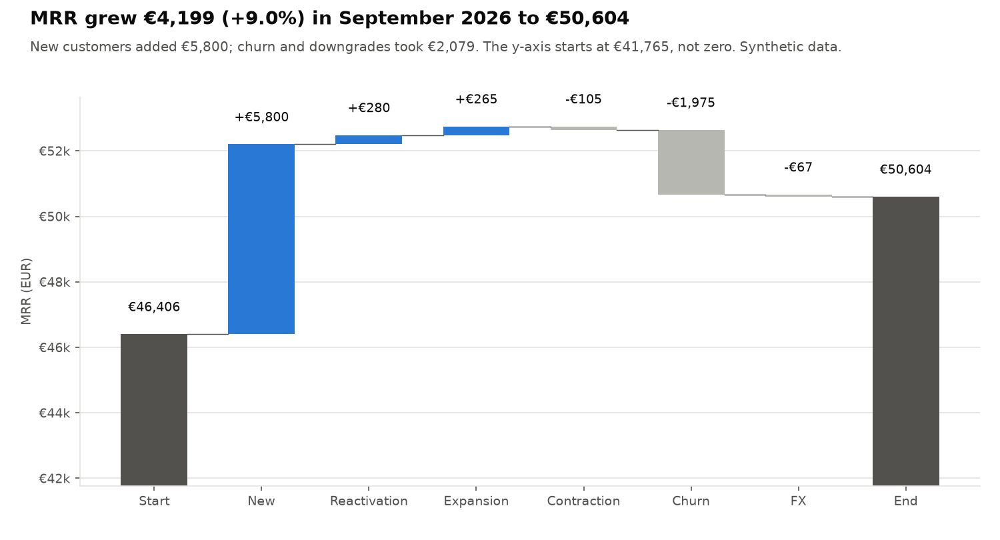
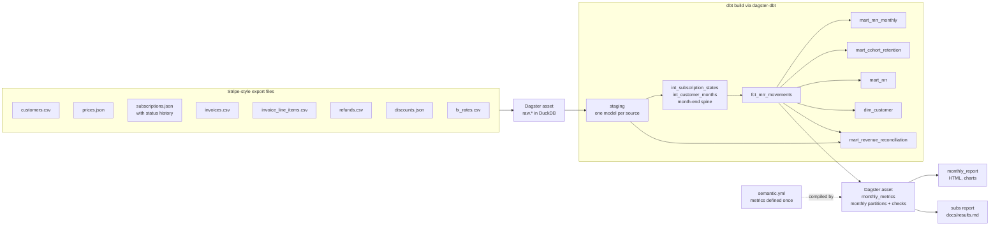
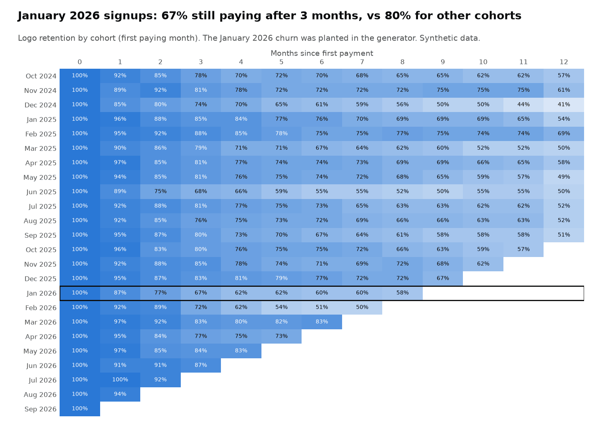

# Subscription analytics: MRR, churn and cohorts with dbt, Dagster and a semantic layer


An analytics engineering project for an online language school that sells monthly and annual
plans through Stripe. I run HaiEduTech, a small online language centre that takes payments with
Stripe, so this is the reporting I want for my own business. The project answers three
questions: **what is our MRR, why did it change this month, and which cohorts churn?**
Stripe-style exports (customers, prices, subscriptions with status history, invoices with
proration lines, refunds, coupons, a monthly FX table) are loaded into DuckDB, modelled with
**dbt**, orchestrated as **Dagster software-defined assets**, and every metric is defined once
in a **dbt semantic layer** file. Everything runs offline on seeded synthetic data.

**What this project shows**

- **The MRR rules that usually go wrong, written down and tested**: mid-cycle upgrades with
  proration, annual plans (amount / 12), refunds after churn, 100% coupons (MRR 0), trials
  (not MRR), past_due (still MRR), cancel at period end, reactivations, EUR and USD with a
  monthly FX table. 13 hand-written customers, each with a test against MRR computed by hand.
- **An MRR bridge that always closes**: new, expansion, contraction, churn, reactivation, and a
  separate FX line, so a weaker dollar is never called churn. A dbt test checks every month.
- **MRR reconciled to Stripe invoices**: billed MRR rebuilt from invoice lines matches MRR to
  the cent once two named differences are taken out (once coupons, unpaid past_due invoices).
- **One metric definition, used everywhere**: MRR, ARR, net new MRR, logo churn, revenue churn,
  NRR and ARPA live in `semantic.yml`. dbt validates it, MetricFlow can query it, and a small
  compiler turns it into the SQL that the Dagster metrics asset and the report use. A test
  edits the YAML and checks that the report follows.
- **Dagster assets with monthly partitions and asset checks**: raw load -> dbt (via
  dagster-dbt, dbt tests become asset checks) -> metrics -> report; materialised in-process in
  the tests and in CI.



## Problem

Stripe tells you what was invoiced, not what your recurring revenue is. A customer who upgrades
on the 20th gets a credit and a charge on a separate invoice. An annual customer pays twelve
months at once. A scholarship seat with a 100% coupon looks like a customer but pays nothing. A
refund arrives two weeks after the customer left. A US learner pays in dollars. If the MRR model
gets any of these wrong, the founder makes decisions on the wrong number. So the question is
not only "what is MRR?" but "can I prove it is right?"

## Architecture



Step-by-step code walkthrough with the worked edge cases: **[docs/how-it-works.md](docs/how-it-works.md)**.
Why each choice was made: **[docs/decisions.md](docs/decisions.md)**.

## Quick start

```bash
python -m venv .venv && source .venv/bin/activate
make install          # pip install -e ".[dev,metricflow]"
subs run-all          # generate -> all Dagster assets in-process -> docs/results.md (about 30 s)
open reports/2026-09/report.html
```

The Dagster UI:

```bash
subs generate         # the export files the raw asset loads
dagster dev           # http://localhost:3000, then materialise everything for a month
```

Single steps: `subs generate`, `subs load --source-dir <export folder>`,
`subs materialize --month 2026-09-01`, `subs report`. The same assets also run with
`dagster asset materialize --select '*' --partition 2026-09-01 -m subs_analytics.definitions`.
To query a metric with dbt's own engine: `cd dbt && DBT_PROFILES_DIR=. mf query --metrics mrr,nrr --group-by metric_time__month`.

## Results

Synthetic data (seed 42, 2,013 customers over 24 months), from [docs/results.md](docs/results.md).
September 2026, the last month:

| Metric | Value |
| --- | --- |
| MRR | €50,604 (+€4,199, +9.0% on the month) |
| ARR | €607,254 |
| Net new MRR (excl. FX) | +€4,265 |
| Paying customers | 1,105 |
| ARPA | €45.80 |
| Logo churn rate | 4.2% |
| Gross revenue churn rate | 4.5% |
| Net revenue retention (12 months) | 66.5% |

| Bridge | EUR |
| --- | --- |
| Starting MRR | €46,406 |
| New | +€5,800 |
| Reactivation | +€280 |
| Expansion | +€265 |
| Contraction | -€105 |
| Churn | -€1,975 |
| FX | -€67 |
| Ending MRR | €50,604 |

**Why did MRR change?** A back-to-school month: new customers brought €5,800. Churn took €1,975,
mostly from monthly plans (36 monthly customers, 6 annual).

**Which cohorts churn?** Three months after their first payment, 67.2% of the January 2026
cohort were still paying, against 80.0% for the other cohorts on average.



**Is the number right?** Billed MRR rebuilt from invoice lines matches MRR in all 24 months
with an unexplained difference of €0.00 (largest: €0.00006, float rounding). Calendar-normalised
recognised revenue stays within 3.0% of average MRR from January 2025 on. dbt build: 17 models,
47 data tests passed.

The January cohort, the summer churn, the September campaign and the edge cases were **planted
on purpose in the generator**. The point is that the models find them from the raw exports
alone. NRR of 66% is what a consumer business with 4-6% monthly churn and little expansion
looks like; it says nothing about any real school.

## Design decisions (summary)

- **MRR is a month-end snapshot** of subscription state, not a sum of invoices: active and
  past_due count, trials and canceled do not; annual = amount / 12; repeating and forever
  coupons reduce MRR, once coupons do not.
- **Movements are classified in local currency**, and the FX effect is its own bridge line:
  `prev_local x (rate_now - rate_prev)`. The bridge still closes exactly.
- **Reconcile two ways**: an exact one (billed MRR from invoice lines, explained differences,
  fails the build) and a tolerance one (recognised revenue, warns).
- **The dbt semantic layer is the single definition**; a 190-line compiler turns it into SQL
  for runtime use, and MetricFlow cross-checks it in a test.
- **dbt is a full rebuild, metrics and reports are partitioned by month.** MRR depends on
  history, so partitioning dbt would only add complexity at this size.
- **Cohort = first paying month**, not signup date; reactivated customers stay in their cohort.

Full reasoning, costs and alternatives: [docs/decisions.md](docs/decisions.md).

## Project layout

```
src/subs_analytics/
  generator.py        seeded Stripe-style exports: SubPlan decisions -> Stripe mechanics
  warehouse.py        settings, typed raw load into DuckDB, dbt helpers
  semantic.py         compiler for dbt/models/semantic/semantic.yml
  definitions.py      Dagster assets, checks, partitions, job, schedule
  report.py           results.md, MRR bridge waterfall, cohort heatmap, HTML report
  cli.py              `subs` commands
dbt/
  models/staging/     one model per export file
  models/intermediate/int_subscription_states (validity intervals), int_customer_months (spine)
  models/marts/       fct_mrr_movements, dim_customer, mart_mrr_monthly, mart_cohort_retention,
                      mart_nrr, mart_revenue_reconciliation
  models/semantic/    semantic.yml (metrics) and the MetricFlow time spine
  models/schema.yml   sources and generic tests
  tests/              bridge closes, billing reconciliation, revenue tolerance, no negative MRR
tests/                pytest: generator, edge cases, semantic layer, Dagster
```

## Testing and quality

- **29 test functions (47 cases)**: every edge case against hand-computed MRR and movement
  type; FX conversion and the FX bridge line; bridge closure every month, and a broken bridge
  that the dbt test must catch; billing reconciliation; cohort assignment (trial, reactivation,
  free seat); the semantic compiler (ratio with zero denominator, injection and cycle
  rejection, unknown dimension); semantic metrics equal the marts; the report follows an edited
  YAML definition; MetricFlow on the same YAML returns the same numbers; Dagster definitions
  load, every asset materialises on a tiny dataset with all checks passing, and a metrics
  partition re-run is idempotent; generator determinism, Stripe date clamping, proration
  amounts, coupon durations, the export cut-off.
- **dbt**: 47 data tests (unique, not_null, relationships, accepted_values, 4 singular tests).
- **CI**: ruff, mypy, `dbt parse` (validates the semantic layer), `dagster definitions validate`,
  pytest with an 80% coverage gate (96% locally), the full `subs run-all` on 2,000 customers, and
  the same assets through `dagster asset materialize`.

## What I'd do next

- Load a real HaiEduTech Stripe export with `subs load --source-dir` (the file layout is in
  [docs/how-it-works.md](docs/how-it-works.md#8-loading-a-real-stripe-export)); it has not
  been run against a real Stripe account yet.
- Incremental dbt models with a lookback window instead of full rebuilds, once the data grows.
- Daily MRR (Stripe's dashboard definition) next to the month-end snapshot, and a reconciliation
  against Stripe's own MRR figure.
- Quantity-based (per-seat) prices for school licences, and multi-item subscriptions.
- Freshness checks on the raw assets and an alert when the billing reconciliation breaks.

Data: all data is synthetic, produced by `src/subs_analytics/generator.py`. The export format
follows the public [Stripe API object shapes](https://docs.stripe.com/api); no Stripe data or
code is included.
